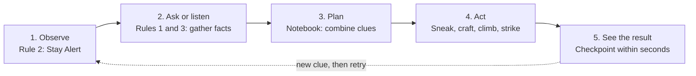
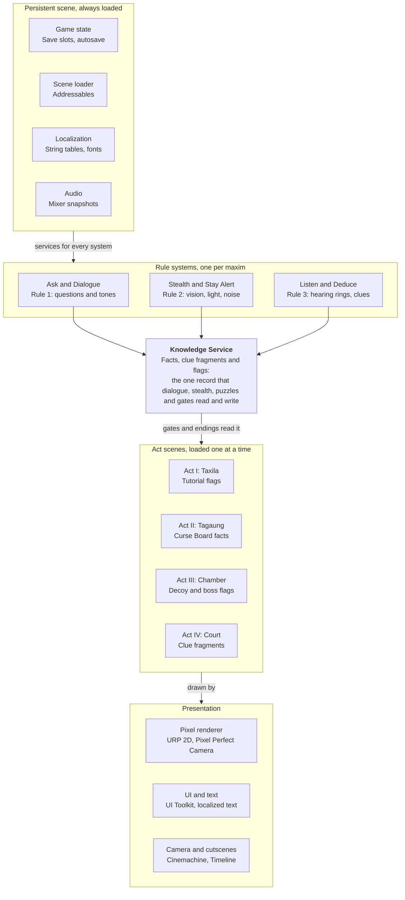

# The Legend of Maung Pauk Kyaing — Game Design Document

Oct 16, 2026 · @HAN

## Vision & Pillars

*The Legend of Maung Pauk Kyaing* is a pixel-art, JRPG-styled action-adventure where a young scholar defeats a dragon, a cursed palace and a deadly riddle with wits instead of weapons.

**High concept.** A graduate of the academy at Taxila walks into the grieving city of Tagaung to marry a princess whose grooms all die before dawn. He carries no relic, only three maxims from his master: ask, stay awake, keep your mind sharp. Each maxim is a rule the player uses in play, and each one solves one act.

| Item | Decision |
| --- | --- |
| Genre | Pixel-art action-adventure, puzzle-platformer, with JRPG presentation (dialogue, towns, boss set-pieces) |
| Perspective | Side-scrolling 2D pixel art, drawn at 480×270 and shown at 4×: sprite characters on one walking plane, in front of layered parallax backdrops |
| Engine | Unity 6 LTS, Universal Render Pipeline (see Unity Technical Design) |
| Platforms | PC first (Windows, macOS); Android as a stretch goal |
| Length | About 2 hours for Part 1 (Acts I to III) and 45 minutes more for Part 2 (Act IV) |
| Languages | Burmese (Unicode) and English at launch; built English first, with Burmese added before release |
| Audience | Ages 12+; story-driven players who like puzzles and stealth over combat |
| Rating target | PEGI 12 / ESRB T (fantasy violence, no gore) |
| Release | Two parts, after an Act I playtest on 31 December 2026: Part 1 (Acts I to III) around mid-June 2027, Part 2 (Act IV) around October 2027 |

### Design pillars

1. **Wits over weapons.** Every threat has a non-violent answer. The dagger is a last resort, and the only killing blow in the game is earned by a plan.
2. **The Rules are the hints.** Rule #1, #2 and #3 are in-game verbs and in-game prompts. The player always knows which rule applies, never exactly how.
3. **Knowledge is the reward.** Overheard lines, NPC answers and room details are the currency. There is no XP grind; progress is what the player learns, and Maung Pauk Kyaing writes the important parts in his notebook so nothing is lost.
4. **A Myanmar story, told with Myanmar eyes.** Names, architecture, music, clothing and folklore come from Myanmar sources and are checked with Burmese consultants.

### What makes it different

- A boss fight won by preparation: the player builds the decoy before the dragon arrives.
- A final boss that is a riddle, solved with evidence the player gathered by eavesdropping.
- A JRPG look and pacing in a short, replayable, four-act package.

## Story, Setting & Cast

A scholar with three maxims and a dagger outwits a monster, a curse and a court, and ends the story as king of Tagaung. The tone is a warm folk tale with real dread in Act III and a clever, satisfying win in Act IV.

### Synopsis

1. **Act I, Taxila.** Maung Pauk Kyaing finishes his studies. His master gives him no weapon, only three maxims: ask questions to find the path, stay awake to stay safe, keep your mind sharp to live long.
2. **Act II, Tagaung.** The city is in mourning. By asking questions he learns that the princess is cursed: each night a new groom is chosen, and each morning he is found dead. His boldness gets him chosen as the next groom.
3. **Act III, the bridal chamber.** Awake in the dark, he sets a decoy of a banana trunk in his marriage robes and waits in the rafters. A dragon king slides from a hidden vent, bites the decoy and is slain while stuck.
4. **Act IV, the throne room.** The princess, secretly grieving her dragon, sets him a riddle on pain of death. He eavesdrops under the floorboards, learns the answer, solves it in court and is crowned.

### Setting

- **Taxila (Takkatho in Burmese).** A misty mountain academy of stone halls, bells and prayer flags. Burmese tradition gives us the word *tekkatho* for "university", taken from this city, so it reads as a home for learning to a Burmese player.
- **Tagaung.** An ancient city on the upper Irrawaddy, remembered in Burmese tradition as an early royal capital. We style it as a Pyu-era teak-and-brick city with a gilded palace, markets, shrines and monasteries.
- **Time.** A legendary past, not a dated one. We borrow Pyu-era architecture and dress and keep the later tiered *pyatthat* palace roof as a recognisable visual cue.

### How this adapts the folk tale

Maung Pauk Kyaing is a legendary king of Tagaung known as *Naga-Naing Min*, "the dragon-slayer king". The traditional telling and our version differ in these places, which we change on purpose:

| Element | Traditional telling | This game |
| --- | --- | --- |
| Hero | A lazy student at Taxila who is sent off with three maxims | A sharp graduate; the title *Naga-Naing Min* becomes his ending |
| The maxims | Keep walking; ask many questions; avoid sleep | Ask questions; stay awake; keep your mind sharp. "Keep walking" survives as the Act I journey |
| The bride | A queen whose husbands die on the wedding night; ministers offer the crown to whoever marries her | A princess; the king picks a new groom each night |
| The decoy | Bunch of bananas in the bed; hero hides behind a pillar | Banana trunk in marriage robes; hero hides in the rafters |
| The aftermath | Queen has the hide made into pillows and a bone into a hairpin | Hide made into a hidden tunic |
| The riddle | 40 days; hero fails; his parents overhear two crows | 24 hours; the player eavesdrops on the maids themselves |
| After the ending | Queen bears twin sons who later found Sri Ksetra | Optional sequel or DLC hook |

The princess takes the traditional queen's name, Vācaṇṇī. Burmese spellings of all names are still to be confirmed.

### Cast (working names, to confirm with a Burmese consultant)

| Character | Role | Appears | Gameplay function |
| --- | --- | --- | --- |
| Maung Pauk Kyaing | Player character, a young scholar | All acts | Dagger, three Rules, climb and crouch |
| Sayagyi U Thuriya | His master at Taxila | Act I, echoes later | Teaches the Rules; his voice cues hints |
| Daw Khin Gyi | Tea-shop owner in Tagaung | Act II | Gossip hub, first clue-giver |
| Ko Lay | Street boy and errand runner | Act II | Shortcut guide, trades rumours for favours |
| U Ba Thein | Grieving father of a dead groom | Act II | Tells the curse story, unlocks the palace route |
| Bo Hmu Zeya | Captain of the royal guard | Acts II to IV | Gatekeeper, stealth threat |
| Ponnya Saya U Kyaw Zin | Court astrologer | Acts II and IV | Hints that the curse is not natural |
| Wungyi U Min Htet | Chief minister | Act IV | Sits as judge of the riddle |
| King Thiri Dhamma Yaza | Ruler of Tagaung | Acts II and IV | Picks the groom, gives 24 hours, passes the crown |
| Princess Vacani | The cursed princess | Acts III and IV | Cold in Act III, sets the riddle, confesses to her maids |
| Ma Mya and Ma Nyein | The princess's maids | Act IV | The overheard conversation |
| Naga Min, the Dragon King | Antagonist and secret lover | Act III | Boss, bites the decoy |

## Core Gameplay: The Three Rules

The Three Rules are the tutorial, the hint system and the progression: each rule unlocks one verb, one on-screen prompt and one kind of puzzle, and no rule is solved by fighting.

| Rule | Verb it unlocks | Introduced | Mastered in | How it hints |
| --- | --- | --- | --- | --- |
| 1. Ask questions to find the path | **Ask**: pick questions from a list; answers add facts to the notebook | Act I tutorial | Act II | A `?` bubble marks any NPC who knows something; the right question order opens the route |
| 2. Stay awake to stay safe | **Stay Alert**: hold to see threat cues (sound rings, danger outlines, patrol arcs) | Act I tutorial | Act III | Danger the player could miss pulses on screen while Alert is held; Alert drains a stamina bar |
| 3. Keep your mind sharp | **Listen and Deduce**: eavesdrop zones, then combine two clues in the notebook | Act I tutorial | Act IV | A hearing ring shows where overheard speech can be caught; clue slots light up when two clues fit |

### The hint ladder

Hints escalate only when the player is stuck, and every step can be turned off in Options.

1. **Mood.** The music thins or swells to show the player is near the answer.
2. **Icon.** The relevant Rule icon pulses in the corner of the screen.
3. **Echo.** The master's recorded voice paraphrases the maxim as a nudge, never as a solution.

### Moment-to-moment verbs

Walk and run, jump, climb (ledges, ropes, rafters), crouch and hide in shadow, talk, **Ask**, **Stay Alert**, **Listen**, combine items, and use the dagger. The dagger is a tool: it cuts ropes and vines, chops the banana trunk and lands one scripted finishing blow. There is no free melee combat and no random encounters.

### The Notebook

Maung Pauk Kyaing is a scholar, so he writes down what matters. After an important conversation or an overheard secret he takes out his notebook and writes the point in his own words. The player can read it back at any time, so a player who forgot a clue, or returns after a week away, is never lost.

**What gets written**

- Only *important* information: a fact that opens a gate, a clue fragment, a name or relationship, a warning, a place or a time. Small talk stays out. Designers mark the important lines in the dialogue data.
- Each entry is a short note in the hero's voice, for example: *"Daw Khin Gyi: every groom is dead by morning. No one will say how."* It is a summary with some personality, not a copy of the dialogue.
- Each entry records who said it, where, in which act and which Rule found it, shown as a small Ask, Alert or Listen stamp.
- Entries state what was learned and never what to do next.

**When it is written**

- **After Ask.** When a conversation ends, he is shown writing for one to two seconds, with a stylus scratch and a small *Notebook updated* mark. The player can skip it.
- **After Listen.** While hiding he does not write. He jots the notes as soon as he is safe, such as when he leaves the hearing ring or reaches cover, so stealth stays tense and nothing is lost.
- **Partial entries.** A conversation cut short makes an entry with blank lines. The blanks fill in if the player hears the rest, which ties to the fragments in Eavesdropping.
- **Act I.** The master speaks the three maxims and the hero writes them as the first entry. This teaches the notebook.

**Reading it back**

- The notebook opens from anywhere outside cutscenes and pauses the game, including the 24-hour clock in Act IV.
- Four tabs (Facts, People, Map, Mind), with entries grouped by act and a search by person. The tabs are described in UI/UX.
- Opening an entry shows his note, and below it the original lines as quotes, so the player can re-read exactly what was said.
- The first page, *What I'm working out*, holds one line with the current open question, always phrased as a question, for example "Why do the grooms die only at night?" It stands in for quest markers and can be switched off in Options.
- Entries use the same readable Unicode font as dialogue, on a paper background. The handwritten feel comes from an ink-reveal animation, not a decorative font, so the Burmese version can reuse the same notebook.

### Core loop

Observe the scene, ask or listen, plan in the notebook, act (sneak, craft, climb), then see the consequence. A failed plan returns the player to a nearby checkpoint within seconds, with a new clue instead of a punishment.

The accent line is the safety net: a failed plan adds a clue instead of a penalty.

### Progression

There is no XP. Each Rule has three ranks, earned by finishing optional challenges: a second follow-up question per NPC, a longer Alert, a wider hearing ring. This gives JRPG-style growth through knowledge.

## The Four Acts

Each act teaches one Rule, changes the play mode and ends on a clear transition. A first playthrough takes about 2 hours 45 minutes in total: about 2 hours for Part 1 (Acts I to III) and about 45 minutes for Part 2 (Act IV).

| Act | Setting | Mode | Rule in focus | Time | Ends when |
| --- | --- | --- | --- | --- | --- |
| I. The Graduation | Taxila, a misty mountain academy | Tutorial, linear platforming | All three, one each | 20 min | He reaches the road to Tagaung |
| II. The Cursed Kingdom | Tagaung streets and markets | Hub exploration, NPC questions, light stealth | Rule 1, Ask | 60 min | The king chooses him as groom |
| III. The Dragon in the Dark | Royal bridal chamber and palace garden | Survival horror, boss puzzle | Rule 2, Stay Alert | 40 min | The Dragon King is dead |
| IV. The Ultimate Riddle | Floorboards, then the throne room | Stealth, then a dialogue duel | Rule 3, Listen and Deduce | 45 min | He is crowned |

### Act I. The Graduation & The Three Rules

- **Goal.** Teach every control and every Rule without a single fail screen.
- **Flow.** (1) Graduation hall: the master gives the three maxims, the hero writes them on the first page of his notebook, and the player asks him three questions to learn **Ask**. (2) Night dormitory: stay awake and catch a thief with **Stay Alert**. (3) Library gate: combine two scroll clues to open it, learning **Listen and Deduce** and the notebook. (4) The winding path down the mountain: rope bridges, ledges and a long scroll with scenery, ending at a fork where a traveller points the way to Tagaung.
- **New mechanics.** Move, jump, climb, crouch, dagger-cut, Ask, Stay Alert, notebook.
- **Fail state.** None. A missed step puts him back a few paces.

### Act II. The Cursed Kingdom of Tagaung

- **Goal.** Learn what is wrong with the city, and be seen doing it.
- **Flow.** Five districts: the river gate, the market, the tea shop, the monastery courtyard and the palace gate. Each holds NPCs who know one piece of the curse. The notebook's *Curse Board* needs at least three of six facts to move on; the rest give a better starting kit for Act III.
- **Six facts.** (1) Every groom dies by morning. (2) The king chooses the next groom each evening. (3) The dead have no wound, only a mark on the skin. (4) The astrologer says the curse is not natural. (5) The bridal chamber has a hidden vent. (6) The palace garden has banana trees.
- **Light stealth.** Guards break up talk about the curse. A visible *Rumour* meter fills when Ask is used near a guard. Full means he is detained and sent back to the last street.
- **Transition.** After enough questions, the captain of the guard reports the stranger to the king, who picks him as the next groom. The player cannot refuse; the scene plays as a short, tense cutscene.
- **Fail state.** Detained, then retry. No loss of facts already learned.

### Act III. The Dragon in the Dark

- **Goal.** Survive the night by preparing for it.
- **Phase 1, the garden (about 8 min).** Escorted through the palace garden, the player chops a banana trunk with the dagger and carries it (slower and louder) back to the chamber before the guards return.
- **Phase 2, the decoy (about 5 min).** The princess turns her back and will not look at him. The player lays the trunk on the bed and dresses it with robe, headcloth and pillow. A better decoy buys more time before the dragon sniffs it out.
- **Phase 3, the rafters (about 10 min).** He climbs the curtain and shelf to the rafters. **Stay Alert** shows the vent, the princess's glances and the sound rings of creaking wood. Too much noise makes her turn and the dragon enters early.
- **Phase 4, the boss (about 15 min).** The Dragon King slides from the vent at midnight, circles the room, bites the decoy and sprays venom. His fangs are stuck for a short window.
  - *Lure:* stay still in the rafters while the dragon hunts.
  - *Stuck:* drop from the rafters when the stuck-ring on the floor is filled.
  - *Thrash:* dodge venom pools across the bed and floor, then land the finishing dagger strike on the neck.
- **Fail state.** A bite or venom hit returns the player to the rafters with the dragon still stuck, so each retry is under a minute.

**End of Part 1.** When the dragon dies, a short cutscene of about 2 to 3 minutes shows the morning after: the court's shock, the princess's riddle and the king's 24 hours. The screen then reads *End of Part 1*. It is the Act IV court scene, trimmed; if time is short it becomes a sequence of still images.

### Act IV. The Princess's Revenge & The Ultimate Riddle

- **Goal.** Find the answer to the riddle before 24 in-game hours pass.
- **Phase 1, the court (about 6 min).** The kingdom is shocked to see him alive. The princess poses the riddle before the king: *"A problem arose from love, a shirt was made from the hide, and a man died because he didn't know. What am I?"* The king grants 24 hours.
- **Phase 2, the floorboards (about 25 min).** He crawls through the crawl space below the palace. Footsteps overhead show guard patrols. He reaches the princess's rooms and hears her weeping and telling her maids that she skinned the dragon and had a hidden tunic sewn from the hide. Three clue fragments are caught: **love**, **hide** and **the man who did not know**.
- **Phase 3, the answer (about 14 min).** In the throne room the player places the three fragments in the answer slots and chooses how to deliver it.
- **Choices.** Reveal the tunic publicly, or speak it softly and spare her. The answer is the same; only the epilogue changes.
- **Fail state.** Skipping the eavesdrop leaves blind guesses and a wrong answer means execution. The game returns to the start of the 24 hours with the three clue locations hinted.

**Part 2.** Act IV is released as Part 2. It opens with the 24-hour clock already running, after a one-minute recap of the court scene for players who start there.

## Systems

Five systems carry the game: questions, stealth, eavesdropping, the decoy-and-boss encounter and the riddle. Each is data-driven so content can be tuned without code changes. All numbers below are starting values for playtests.

### Question system (Rule 1)

- Each NPC holds 2 to 4 questions. Asking one adds a *fact* to the notebook with its source NPC.
- The player picks a **tone** before asking: *Polite*, *Bold* or *Charming*. Each NPC prefers one tone; the wrong tone makes them close up for a short time. This is how "confidence and charm" in the brief becomes a mechanic.
- Facts are the only gates. A door, route or ending flag opens when its required facts are in the notebook.

### Stealth (Rule 2)

- The world is one walking plane, with no depth lanes. **Hiding spots** (alcoves, curtains, big jars, deep doorways) let the hero step in with Interact and turn into a dark silhouette. A guard walks past unless he saw the hero go in. Doors and stairs lead to other rooms and floors.
- Guards use a vision cone with four states: *Unaware*, *Suspicious* (`?` over the head, about 2 seconds), *Alert* (`!`) and *Detain*.
- Shadow hides the player; lantern pools do not. Noise comes from running, carrying heavy items and loose boards, and is shown as sound rings.
- **Stay Alert** reveals guard arcs and hidden hazards but drains stamina and slows movement, so it is used in bursts.

### Eavesdropping (Rule 3)

- Overhearing happens inside a hearing ring around a conversation. The player keeps inside the ring while a *signal bar* fills.
- A broken signal still gives a *fragment* of the conversation. Fragments are written into the notebook as partial entries and can be replayed.
- Conversations are replayable at checkpoints so a mistake never blocks the story.

### Decoy and boss encounter (Act III)

- **Decoy quality** is a 0 to 100 score from three checks: a trunk of the right size, a robe wrapped over it and a headcloth and pillow for the head. A higher score delays the dragon's recognition.
- The Dragon King is a small state machine: *Hunt, Bite, Stuck, Thrash, Recover*, then a second cycle with faster *Hunt*, then death.

| Parameter | Story mode | Standard mode |
| --- | --- | --- |
| Stuck window (seconds) | 8 | 5 |
| Venom pool lifetime (seconds) | 3 | 5 |
| Cycles before death | 1 | 2 |
| Noise tolerance before princess reacts | High | Medium |

### The riddle (Act IV)

- The riddle has three slots: **love**, **hide** and **the man who did not know**. Each slot has 3 candidate answers in the notebook; only the fragments overheard in Phase 2 mark the right one.
- The player cannot brute-force: a wrong final answer ends in execution, and the game returns to the start of the 24 hours.
- The delivery choice (reveal publicly or speak softly) only changes the epilogue.

### Failing forward

Failure is always short and never loses information the player has already learned. Checkpoints sit before each puzzle step and the notebook is never rolled back.

### Difficulty & accessibility

- Two modes, *Story* and *Standard*, switchable at any time. The hint ladder in Core Gameplay can be fully turned off.
- Hold or toggle for Stay Alert. Remappable keys. No timed button-mashing.
- Every icon pairs a shape with a colour. Subtitles and dialogue scale from 100% to 200%.
- A *reduced flashing* option tones down the venom splashes and screen flashes in Act III.

## Art Direction

The look is pixel art: the world is drawn at 480×270 and shown at 4× on a 1080p screen, each scene on one limited palette, lit by warm lanterns against cool night. All text and UI stay in smooth, high-resolution fonts, so Burmese reads cleanly. This replaced the earlier HD-2D plan on 21 October 2026, after a pixel test of the main menu.

### Visual recipe

- **Resolution:** a 480×270 canvas, scaled by whole numbers only (4× at 1080p, 8× at 4K), so every pixel stays square. The camera and moving layers step in whole pixels.
- **Characters and enemies:** pixel sprites about 32 to 48 pixels tall for people, each with a 1-pixel outline in a dark shade of its own colour, not black.
- **Big set pieces:** the naga, the palace and other large forms are modelled in Blender, toon-shaded in three steps and rendered small, then pixelized and touched up by hand. One model gives every angle and animation frame.
- **Environments:** layered 2D pixel backdrops with parallax (sky, far hills, buildings, ground, foreground), not a 3D diorama.
- **Palette:** each scene shares one palette of at most 48 colours, built from the act's key colours below. Glowing eyes and lantern light keep reserved colours, so they never merge into the gold.
- **Shading:** flat bands with a hue shift, cool blue-purple shadows and warm highlights. Serpents get regular scale rows and plated bellies, never noisy texture.
- **Lighting:** warm lanterns and candles against cool blue night shadows. Light is a gameplay signal: lit areas are unsafe, shadow is cover. Glows, mist and light shafts are soft overlays above the pixels.
- **Text and UI:** smooth, full-resolution fonts for dialogue, menus, the notebook and all Burmese text. Pixel art is for frames, icons and portraits only.
- **Post-processing:** bloom on lanterns, vignette and colour grading only. No depth-of-field blur, tilt-shift or film grain, which smear pixels.

The main menu test: the palace, the guardian naga and the hero are pixel art on one palette, while the title and menu stay smooth.

### Palette and mood by act

| Act | Mood | Key colours | Light |
| --- | --- | --- | --- |
| I. Taxila | Calm, wistful | Pale jade, mist grey, saffron robes | Soft morning fog, golden sun shafts |
| II. Tagaung | Busy, uneasy | Brick red, teak brown, turmeric yellow, black mourning cloth | Warm market light, cold alleys |
| III. The chamber | Dread, intimacy | Deep indigo, oxblood, a little gold | One candle, long shadows, moonlight through lattice |
| IV. The throne room | Pomp, then triumph | Gold leaf, vermilion, white marble | Bright courtly daylight, dark crawl space below |

### Myanmar visual motifs

- Tiered *pyatthat* roofs, teak carving, lacquerware, gilded stupas and brick shrines, with Pyu-era brick architecture as the base.
- Clothing: *longyi*, *eingyi* jackets and the *gaung baung* headcloth; the hero wears simple white student robes and a plain scarf, the court wears silk and gold.
- Naga as a design language: serpent-shaped balustrades, bargeboards and the dragon boss's curling silhouette.
- Patterns from Burmese lacquer and *kalaga* tapestry appear on UI frames and loading screens.
- Real places to study for reference include the Pauk Kyaing Pagoda at Tagaung and the Pyu brick monuments at Sri Ksetra.

### Character design

- **Maung Pauk Kyaing:** slim, quick, with a cloth satchel and a plain dagger. A readable silhouette from 50 metres away: white robe, red scarf.
- **Princess Vacani:** elegant and cold, deep indigo silk, gold hair ornaments. Her palette softens in Act IV.
- **Dragon King:** a long, hooded naga with a flat head, lacquer-black scales and a gold-green sheen. It reads as majestic first and monstrous second.
- **NPCs:** distinctive silhouettes and colours per district, so a crowd stays legible.

### Animation and VFX

- Walk and run in 6 to 8 frames, idle in 4, plus 2-frame hit and surprise poses for the JRPG dialogue style.
- Dialogue portraits are 128×128 pixel art shown at 4× (512 pixels on screen), with 4 to 6 emotion variants for main characters.
- The naga's animations are posed in Blender and rendered straight to pixel frames, then cleaned up by hand.
- Boss VFX: venom drips, dust, ripples on the lacquered floor and candle flicker, as pixel sprites on the scene's palette. Only glows and fog are soft.

### The notebook as an object

- A bundle of palm-leaf pages tied with a cord, or a folding *parabaik* manuscript. The cultural consultant makes the final choice, and it must still read as a notebook to a first-time player.
- It wears with the journey: clean pages in Act I, creased and smudged in Act III, neat again in Act IV.
- Sketch portraits of the people he meets, a rough map of Tagaung and small margin doodles of the dragon and the princess make it feel written by a person.

## Audio & Music

Audio is part of the gameplay: the player listens for guards, the dragon and secret conversations, and the music tells them how close they are to the answer. The score uses real Burmese instruments, recorded by Burmese performers where the budget allows.

### Instrument palette

- *Saung* (arched harp), *pattala* (xylophone) and *palwei* (flute) for intimate, melodic scenes.
- *Hsaing waing* ensemble: *pat waing* (drum circle), *kyi waing* (gong circle), *hne* (double-reed oboe) and *si* and *wa* (bell and clapper) for markets, courts and celebration.
- *Mi gyaung* (crocodile zither) as a rare, strange colour for the dragon.
- Burmese music uses its own tunings and modes. We record real instruments and consult a Burmese musician instead of imitating them with Western scales.

### Music by act

| Act | Musical idea | Core instruments |
| --- | --- | --- |
| I. Taxila | Quiet wonder; a long walk | Saung, palwei, soft bells |
| II. Tagaung | Busy markets over a held-breath mourning | Pat waing, hne, muted gongs; each district has its own variation |
| III. The chamber | Near silence; a heartbeat and one slow string | Low kyi waing, sustained drone, mi gyaung for the dragon |
| IV. The throne room | Pomp, then triumph | Full hsaing waing in the court; muffled wood and dripping in the crawl space |

### Adaptive music

- Each theme is built as 3 to 4 layered stems: *calm*, *tension*, *danger* and *answer-near*. The game fades layers in and out from guard states, the Rumour meter and puzzle progress.
- Stay Alert ducks the music and raises ambience so the sound rings can be heard.
- Unity Audio Mixer snapshots cover the MVP. FMOD Studio is an option if the team wants a dedicated audio tool.

### Sound effects

- **Stealth:** footsteps change by floor material (stone, teak, tile), creaking boards, cloth, breathing, dripping and distant bells.
- **Dragon:** slithering on lacquer, a low hiss, jaw snap, venom sizzle. Each is loud enough to cue the boss phase without UI.
- **UI:** short wooden clicks and bell chimes for dialogue, plus a stylus scratch and a soft page turn when the notebook is written or opened.

### Voice and language

- Main story scenes and the master's three maxims are voiced in Burmese, recorded in M4 once the English script is locked. Other lines use short voiced reactions (hmm, oh, ah) that work in any language, so the budget stays small.
- The game launches with English and Burmese text. It is written in English first and Burmese is added in M4. English voice is out of scope.
- The master's "echo" hints need 9 short lines (three phrasings per maxim): text during development, voiced in Burmese in M4.

## UI/UX, Controls & Localization

The interface stays out of the way: the notebook holds the story's memory, the HUD shows only what the current Rule needs, and all text lives in string tables from day one so the game is built in English first and Burmese is added before launch.

### Screens

- **HUD.** A small stamina ring beside the hero while Stay Alert is held, a Rumour meter in Act II, a Rule icon that pulses on hints and nothing else. No quest markers.
- **Dialogue.** JRPG layout: a box at the bottom of the screen, a speaker name, and a large portrait on the left or right. For Ask, a radial list of questions and a *tone* selector (Polite, Bold, Charming).
- **Notebook.** Four tabs: *Facts* (what the player learned, with its source), *People*, *Map* and *Mind* (clue fragments and the riddle slots). New entries show a small dot. How entries are written is covered in Core Gameplay, The Notebook.
- **Menus.** Pause, Options (hints, difficulty, text size, key remap), Save slots, and a Chapter select after the first ending.

### Controls

| Action | Keyboard and mouse | Gamepad |
| --- | --- | --- |
| Move | A, D or arrow keys | Left stick |
| Jump | Space | A / Cross |
| Climb | W, S | Left stick up and down |
| Crouch | Left Ctrl | B / Circle (hold) |
| Interact, talk and hide | E | X / Square |
| Ask (open question wheel) | Q during talk | Y / Triangle |
| Stay Alert | Left Shift (hold or toggle) | Left trigger |
| Dagger | F | Right trigger |
| Notebook | Tab | View / Select |
| Pause | Esc | Start |

Next to a hiding spot, Interact hides the hero; press it again or move to step out. Listening needs no button: the player stands still inside a hearing ring. Controls are built on Unity's Input System so touch controls can be added later for an Android build.

### Localization

- Launch languages: **English** and **Burmese (Unicode)**. The game is built English first, and Burmese is added in M4, before release. All text lives in string tables from day one, using Unity's Localization package, so adding a language is a content task, not a code change.
- When Burmese is added, the game ships its own Burmese fonts, so the player's phone or PC encoding does not matter. Candidate open-licensed fonts are Noto Sans Myanmar and Padauk; check the licence before shipping.
- Design the UI for Burmese now, even though development text is English first: Burmese uses spaces between phrases, not words, and its stacked glyphs are tall, so boxes need extra line height, a minimum size of about 24 pixels at 1080p and room for longer lines.

### Burmese text rendering plan

Burmese is a complex script: consonants stack, vowels reorder and marks position themselves, so text needs OpenType shaping, not a glyph-by-glyph lookup. This is the biggest technical risk in the project, because launch now waits for Burmese. Development is English first, so the full test can come late, but the UI stack chosen in M0 must not rule Burmese out (see Risks).

1. **Check in M0, full test in M4.** Render a test sheet of hard Burmese strings (long stacks, medials, line breaks) in each option below, on Windows, macOS and Android. In M0 this is a 2 to 3 day check on the chosen UI stack; the full comparison happens at the start of M4.
2. **Option A.** UI Toolkit with the Advanced Text Generator, which uses HarfBuzz for shaping and ICU for line-breaking. Unity's docs do not name Burmese, so this must be proven in the spike.
3. **Option B.** TextMeshPro with a community or custom complex-script patch, if Option A fails. TextMeshPro itself is not documented as supporting complex-script shaping.
4. **Option C (fallback).** Pre-shape all dialogue offline and ship it as glyph-run assets or baked text images. This works but slows content iteration.
5. **Decision gate.** Pick the UI stack at the end of M0 so it does not rule Burmese out, and confirm the final option at the start of M4.

## Unity Technical Design

Build on Unity 6.3 LTS with the Universal Render Pipeline, keep the story and puzzle logic as data, and prove the two risky pieces, the pixel-art pipeline and a text stack that will not rule out Burmese, in the first weeks.

### Engine and version

- **Unity 6.3 LTS (6000.3.x).** It was released in December 2025 and is supported until December 2027, which covers a 12 to 18 month project. Unity 6.7 is the next LTS; do not upgrade mid-project unless a blocking bug requires it.
- **Scripting:** C# with assembly definitions per system for fast compile times. Version control: Git with Git LFS and a Unity-aware `.gitignore`.

### Rendering: how the pixel look is built

Use the URP 2D Renderer with a Pixel Perfect Camera. This replaced the choice between billboard sprites in 3D and the 2D Renderer with 3D meshes on 21 October 2026, when the game moved to pixel art.

| Setting | Choice | Why |
| --- | --- | --- |
| Renderer | URP 2D Renderer with 2D Lights and Shadow Caster 2D | Lantern light and shadow on pixel sprites without a 3D scene |
| Camera | [Pixel Perfect Camera](https://docs.unity.com/en-us/engine/6000.3/manual/unity2d/2d-urp/2d-pixelperfect/ref): Reference Resolution 480×270, Grid Snapping set to Upscale Render Texture | The scene renders at 480×270 and is scaled up to the screen, so pixels stay square, unrotated and unaliased |
| Sprites | One Pixels Per Unit value for every sprite, matching the camera's Asset Pixels Per Unit; point filtering, no compression | Crisp, evenly sized pixels |
| Art files | [2D Aseprite Importer](https://docs.unity3d.com/6000.7/Documentation/Manual/com.unity.2d.aseprite.html) | Sprites and animations come straight from Aseprite files |
| Big set pieces | Rendered from Blender in a toon shader at sprite size, then cleaned up in Aseprite | One model gives every angle and frame, as with the naga |
| Text and UI | UI Toolkit drawn above the pixel layer at full screen resolution | Smooth Burmese and English text |
| Effects | Bloom, glows, mist and light shafts as soft overlays; no depth of field | Atmosphere without smearing pixels |

Whatever the lighting looks like, **stealth never reads the render.** Light and shadow are gameplay *zones* (trigger volumes) that the lights are placed to match, so rules stay deterministic.

### Scene and camera setup

- A persistent boot scene stays loaded. Each act is its own scene loaded additively, with sub-scenes per district or room.
- Cinemachine drives a side camera with soft dead-zones and per-room framing, kept on whole pixels by the Pixel Perfect Camera. Timeline drives cutscenes.
- One walking plane: the hero and guards share a fixed Z. Hiding spots are trigger zones with hide and step-out animations; doors and stairs load other rooms or floors.

### Packages

| Area | Package | Why |
| --- | --- | --- |
| Input | Input System | Keyboard, gamepad and later touch from one action map |
| Camera and cutscenes | Cinemachine, Timeline | Framing and scripted scenes |
| Art | 2D Aseprite Importer, 2D Tilemap Editor, 2D Tilemap Extras, Shader Graph | Pixel sprites and animations from Aseprite, tile-based rooms, palette and glow shaders |
| Content | Addressables | Per-act loading and smaller memory |
| Text | Localization, UI Toolkit | String tables; Burmese shaping (see UI/UX) |
| Dialogue | Ink or Yarn Spinner | Branching dialogue as data; pick after the M0 text check |
| Audio | Unity Audio, optional FMOD Studio | Adaptive stems |
| Quality | Test Framework, Profiler | Logic tests and frame budgets |

### Code architecture

- **Knowledge Service.** One record of facts, clue fragments and story flags. Dialogue, stealth, deduction, gates and endings all read and write it, and the save file stores it.
- **Data first.** NPCs, facts, questions, riddles and encounters are ScriptableObjects or Ink files. Designers add content without code. Notebook entries are data too: each links to a fact or clue fragment and is created by a tag on the dialogue line.
- **Decoupling.** Systems talk through event channels (ScriptableObject events), not direct references.
- **Player controller.** A finite state machine (Idle, Run, Jump, Climb, Crouch, Hide, Alert, Carry, Strike) with one state active at a time.
- **Boss.** A separate state machine for the Dragon King, driven by data (timings per difficulty).

The three Rule systems write what the player learns; act scenes and their gates read it.

### Save system

Autosave at checkpoints and on scene change; three manual slots. A save file is JSON holding the Knowledge Service, current scene, checkpoint ID, settings and Rule ranks. Files are versioned so patches can migrate older saves.

### Performance and build targets

- **PC (Windows, macOS):** 1080p at 60 FPS on integrated graphics from the last five years, scaling up to 4K.
- **Android (stretch):** 30 FPS on mid-range phones, which a 480×270 pixel renderer suits.
- **Budgets:** 150 draw calls and under 2 GB of memory on PC. Use sprite atlases for characters and tilemaps for rooms.
- **Build:** Scripting backend IL2CPP for release, Mono for iteration. CI builds nightly if the team has the capacity.

## Reference Games

Study three games first: Sea of Stars for the pixel look, Mark of the Ninja for stealth feedback and Return of the Obra Dinn for the riddle. The rest each cover one narrower question.

| Area | Game | Developer, year | What to borrow | Where it applies here |
| --- | --- | --- | --- | --- |
| Look and structure | [Octopath Traveler](https://en.wikipedia.org/wiki/HD-2D) | Square Enix and Acquire, 2018 | Pixel characters under warm point lights, and its JRPG presentation (not its 3D sets or tilt-shift) | Lighting mood, dialogue presentation |
| Look and structure | [Live A Live](https://en.wikipedia.org/wiki/Live_A_Live) (HD-2D remake) | Square Enix, 2022 (original 1994) | Chapters that each have their own gimmick, linked by one story | Each act changes the play mode |
| Look and structure | [Sea of Stars](https://en.wikipedia.org/wiki/Sea_of_Stars) | Sabotage Studio, 2023 | Pixel art with dynamic lighting built to match it; a JRPG where the hero runs, swims and climbs across the world | Art direction (the closest pixel look); Act I path, traversal inside a JRPG |
| Look and structure | [Chained Echoes](https://www.windowscentral.com/gaming/chained-echoes-succeeded-where-octopath-traveler-failed) | Matthias Linda, 2022 | A full JRPG made by one developer | Scope check for a small team |
| Look and structure | [Hollow Knight](https://en.wikipedia.org/wiki/Hollow_Knight) | Team Cherry, 2017 | Hand-drawn 2D art shipped in Unity by a small team | Evidence the engine and art choice work |
| Platforming and horror | [Prince of Persia: The Lost Crown](https://news.ubisoft.com/en-us/article/6JaimYMaCUOBlHy98z1unG/prince-of-persia-the-lost-crown-release-date-revealed) | Ubisoft Montpellier, 2024 | A 2.5D side-scroller set in a mythology | Camera framing and lane readability |
| Platforming and horror | [Little Nightmares](https://en.wikipedia.org/wiki/Little_Nightmares) | Tarsier Studios, 2017 | 2.5D "hide and seek" tension; a small hero against huge threats | Act III chamber |
| Stealth | [Mark of the Ninja](https://en.wikipedia.org/wiki/Mark_of_the_Ninja) | Klei Entertainment, 2012 | Noise drawn as an expanding circle; visible in light, hidden in darkness | Sound rings, shadow cover |
| Dialogue, riddles, deduction | [Phoenix Wright: Ace Attorney](https://en.wikipedia.org/wiki/Phoenix_Wright:_Ace_Attorney) | Capcom, 2001 (DS 2005) | Press testimony, present the right evidence, wrong guesses cost a life bar | Question tones; the court scene |
| Dialogue, riddles, deduction | [Return of the Obra Dinn](https://en.wikipedia.org/wiki/Return_of_the_Obra_Dinn) | Lucas Pope, 2018 | Deductions checked in sets of three, which deters guessing | The three riddle slots |
| Dialogue, riddles, deduction | [Professor Layton and the Curious Village](https://en.wikipedia.org/wiki/Professor_Layton_and_the_Curious_Village) | Level-5, 2007 | Villagers pose riddles; three hints, each costing a coin | The hint ladder |
| Boss design | [Shadow of the Colossus](https://en.wikipedia.org/wiki/Shadow_of_the_Colossus) | Team Ico, 2005 | Bosses as puzzles: find the weak point, climb, use the terrain | Dragon King as a prepared trap |
| Local culture | [A Space for the Unbound](https://en.wikipedia.org/wiki/A_Space_for_the_Unbound) | Mojiken, 2023 | A story from late-1990s Indonesia, led by dialogue, made in Unity | A small team telling a local story |
| Local culture | [Raji: An Ancient Epic](https://en.wikipedia.org/wiki/Raji:_An_Ancient_Epic) | Nodding Heads Games, 2020 | Mythology with a regional art style (Pahari painting) and shadow-puppet cutscenes | Grounding the look in a Burmese tradition such as lacquer or *kalaga* |

None of my searches turned up a game based on Burmese folklore, so the closest cultural references are from Indonesia and India. A search of Steam and itch.io by someone with local knowledge is worth doing before launch.

## Act I Playtest Build

Act I ships as an English-only Windows playtest by 31 December 2026, built in the ten weeks from 19 October. It tests whether players understand the three Rules and the notebook before the other three acts are built.

### What the playtest must answer

1. Do players learn Ask, Stay Alert and Listen and Deduce from play, without reading instructions?
2. Do they open the notebook on their own and use it to recall a clue?
3. Do the pixel look and the mood make them want to continue?
4. Do movement and climbing feel good?
5. Where do they get stuck, bored or lost?

### Scope

| Area | In the playtest | Left for later |
| --- | --- | --- |
| Story | All four beats of Act I: graduation hall, night dormitory, library gate and mountain path, about 20 to 25 minutes | Acts II to IV |
| Rules | Ask with one tone (Polite), Stay Alert against one kind of threat, Listen and Deduce with one two-clue combination | Other tones, rank upgrades |
| Notebook | Facts tab, entries with original quotes, first-page question, written after Ask and Listen | People, Map and Mind tabs, partial entries, pinning |
| Movement | Walk, run, jump, climb, crouch | Carry, strike |
| Look | Taxila pixel backdrops on one palette, hero and three NPC sprites, three portraits | Other districts, full cast |
| Audio | Two royalty-free or licensed tracks and about 30 sound effects | Recorded Burmese instruments, adaptive stems, voice |
| Language | English | Burmese |
| Platform | Windows; macOS if time allows; keyboard and gamepad | Android |
| Options | Text size, key remap, hints on or off | Difficulty modes |

### Ten-week plan

| Weeks | Dates (2026) | Goal | Done when |
| --- | --- | --- | --- |
| 1 to 3 | 19 Oct to 8 Nov | Foundations: pixel look prototype (Pixel Perfect Camera, palette, Blender-to-pixel test), UI-text check, player controller, dialogue, Knowledge Service and notebook skeleton | The hero walks and climbs through a lit pixel scene and one conversation writes a notebook entry |
| 4 to 5 | 9 to 22 Nov | Act I greybox with all four beats and placeholder art | A tester can finish Act I without help from the developer |
| 6 to 8 | 23 Nov to 13 Dec | Art, audio and UI pass; notebook art; tuning | Act I looks and sounds as intended; feature freeze at the end of week 8 |
| 9 | 14 to 20 Dec | Internal playtest with 3 to 5 people; fixes; build pipeline and itch.io page | The five biggest problems are fixed |
| 10 | 21 to 27 Dec | Release candidate and publish. 28 to 31 Dec is the buffer | The public build is online |

### Rules for hitting the date

- **Cut scope, not the date.** The Must list is fixed: Ask, Stay Alert, Listen and Deduce, the notebook with quotes, checkpoints, pause and options, English text and the Windows build.
- **Should list, cut first if late:** gamepad support, the macOS build, the second music track, sketch portraits and the first-page question.
- **No new features after week 8.** Weeks 9 and 10 are fixes only.
- **Licensed assets only.** Use purchased or royalty-free assets with a commercial licence, so anything kept for launch has no legal doubt.
- **Week 5 check.** If a tester cannot finish Act I by the end of week 5, cut from the Should list that day.

### Release and feedback

- Publish on itch.io as a free download, with a feedback form linked from the pause menu and the end screen. Steam can come later.
- Ask five things: did you finish, what confused you, what did you like, did you use the notebook, would you play more.
- Watch 3 to 5 people play, in person or over a call. It finds more problems than the form.
- Spend the first half of January 2027 on feedback, and decide whether the Rules or the notebook need changes before Acts II to IV are built.

## Scope, Milestones & Team

The plan is three releases from one developer: an Act I playtest on 31 December 2026, Part 1 (Acts I to III, in English and Burmese) in the week of 14 June 2027, and Part 2 (Act IV) around October 2027. Week 1 starts on 19 October 2026. The Part 1 dates leave no slack, so every milestone has a written cut list, and a date moves only after those cuts. Re-plan Part 2 after Part 1 ships, when your real speed is known.

Each gate is a go or no-go: if it fails, cut scope before moving a date. Phase widths are equal and not to scale. Weeks count from 19 October 2026.

### Scope tiers

| Feature | Part 1 (mid-June 2027) | Part 2 (about October 2027) | Stretch |
| --- | --- | --- | --- |
| Acts | I, II (trimmed hub) and III, plus the short Part 1 ending | IV | New Game+ with a hard riddle |
| Hub NPCs | About 10, from 4 base sprites with palette swaps | None new | More side stories |
| Rules and ranks | All three Rules, rank 1 | Ranks 2 and 3 if time allows | Rank-based secrets |
| Tones | Polite only | Bold and Charming | - |
| Epilogues | None: Part 1 ends on a cliffhanger | Three endings (reveal, spare, silent) | - |
| Languages | Burmese and English, built English first | Burmese and English | More languages |
| Voice | Short voiced reactions; Burmese voice if the budget allows | Burmese voice for key scenes and the master's hints | Full voice |
| Platforms | Windows; macOS if time allows | Same | Android |
| Notebook | Four tabs, partial entries, original quotes, first-page question | Pinned entries | Player notes |

If Part 1 slips, cut in this order: Burmese voice, the macOS build, partial notebook entries, the People and Map tabs, one district of Act II, then the ending cutscene (replace it with still images). Move the date only after these cuts.

### Asset budget (estimate)

| Asset | Count |
| --- | --- |
| Main character sprite sets (hero, princess, dragon, king, master, captain) | 6, each with about 8 animations |
| NPC sprite sets | About 14 (5 base bodies) |
| Dialogue portraits | 8 characters with 5 emotions each |
| Environment kits | 4 (Taxila, Tagaung, palace, chamber and throne room) |
| Music | About 12 tracks with layered stems |
| Sound effects | About 150 |
| Story and notebook text | About 12,000 to 15,000 words in English; Burmese adds the same amount: Part 1 in M4, Act IV in M6 |
| Notebook art | 3 page textures, about 20 sketch portraits, 3 Rule stamps, 1 map sketch |

### Team and roles

You are the only developer. Friends advise and review; they do not need to build anything. Paid help is for a few gaps only: key sprites, the launch music and the Burmese writing.

| Role | Who | When |
| --- | --- | --- |
| Game design, programming, level design, production | You | All phases |
| Pixel art (Blender for big set pieces), UI | You, using licensed pixel asset packs for the Act I playtest; commission the key sprites later | M1 onward |
| Music and sound | Royalty-free or licensed tracks for the playtest; a commissioned composer for launch | M1, then M4 |
| Burmese writing and translation | A Burmese-speaking writer, paid or a friend | Riddle and names in M1; all Part 1 text in M4 |
| **Consulting advisors** | Friends, unpaid; see the next table | Milestone gates |

### Advisors

Name one friend for each row. Each is asked for a small, specific piece of help at a set time.

| Advisor | Helps with | When | The ask |
| --- | --- | --- | --- |
| Game design advisor | Rule clarity, puzzle fairness, pacing; reads changes to this GDD | After the Act I playtest, then at each gate | A 30-minute call and a one-page summary |
| Unity advisor | Architecture, performance, the rendering choice and the Burmese text stack | Week 3 (look and text decision), then before M4 (Burmese text) | A 30-minute call and a screen recording |
| Art advisor | Look, readability, palette, animation feel | Weeks 6 to 8, then at each art milestone | A few screenshots or a short clip |
| Cultural and language advisor | Names, clothing, architecture, the riddle, Burmese wording | M1 review, then M4 | A written checklist to review |
| Playtesters | Fresh eyes on the build | Week 9, then each milestone | A build and five questions |

### Working with advisors

- Keep every ask small and specific: a clip or a build plus two or three questions, not "what do you think?"
- Book review slots at the milestone gates so feedback arrives when you can use it.
- Write the decisions into this GDD so advice is not lost.
- Agree in writing that anything a friend makes for the game (art, music, text) can be used in it, and what credit they get.
- Credit every advisor in the game.

### Production phases

1. **M0, Foundations (weeks 1 to 3, 19 October to 8 November 2026).** Look prototype (A against B), a short UI-text check so Burmese is not ruled out, player controller, dialogue, Knowledge Service and notebook skeleton.
2. **M1, Act I playtest (weeks 4 to 10, to 31 December 2026).** Act I playable and polished as described in Act I Playtest Build, released as an English-only Windows build.
3. **M2, Playtest fixes and Act III (weeks 11 to 19, 28 December to 28 February 2027).** Two weeks of playtest fixes, then Act III in final quality: the decoy, the rafters and the Dragon King, with the short Part 1 ending.
4. **M3, Act II (weeks 20 to 26, 1 March to 18 April).** The hub, trimmed to three districts and about ten NPCs, with the Rumour stealth and the Curse Board.
5. **M4, Burmese for Part 1 (weeks 27 to 32, 19 April to 30 May).** Burmese text shaping implemented, Acts I to III translated and rewritten with a Burmese writer, native-speaker testing. Acts I and III can start translation as soon as they are locked, in January and March.
6. **M5, Polish and Part 1 launch (weeks 33 to 35, 31 May to 20 June).** Bug fixing in both languages, performance, accessibility, store page. Launch in the week of 14 June.
7. **M6, Part 2: Act IV (about weeks 37 to 52, to about October 2027).** The eavesdropping crawl space, the riddle and the three endings, with their Burmese text and a round of fixes from Part 1 feedback. Re-plan after Part 1 ships.

## Risks & Open Questions

The three risks most likely to hurt the project are Burmese text rendering, scope for a small team, and cultural accuracy. Each has an early test or a standing review below.

### Risks

| Risk | Impact | Mitigation |
| --- | --- | --- |
| Burmese text does not shape correctly in Unity | High: launch now waits for Burmese, and the wrong UI stack could force a rewrite | Short M0 check on the chosen UI stack; full three-option test at the start of M4 |
| Scope is too large for one developer | High | Playtest and slice first; written cut order (Android, epilogues, ranks, Burmese voice, tones); licensed assets for the playtest; re-plan after Act I |
| Cultural errors in names, dress, buildings or religious imagery | High | A Burmese consultant reviews names, costumes, architecture and scripts at M1, M2 and M3. Keep Buddha images and monks out of violent or comic scenes |
| The riddle is unfair or reads badly in Burmese | Medium | Design the riddle by its logic (love, the hide, the man who did not know) in English, then a Burmese writer rewrites it instead of translating word for word; test with native speakers who have not seen the story; hint ladder as a safety net |
| Pixel art takes longer than planned, or Blender-rendered sprites clash with hand-drawn ones | Medium | Fix one palette and outline rule per scene in M0; hand-clean only the key sprites; use pixel asset packs for the playtest |
| Stealth feels unfair | Medium | Fail-forward checkpoints, Story mode and visible feedback for every enemy state |
| Overlap with published retellings of the tale | Low | Folk tales are shared heritage, but published retellings are copyrighted. Write original dialogue, names and riddle text |
| The notebook turns into a quest log that tells players what to do | Medium | Entries state what was learned, never the next step; the first-page question can be switched off in Options |
| Burmese translation, voice and native-speaker testing run late and hold the launch | Medium | Start translating each act as soon as it is locked; keep Burmese voice on the cut list |
| The Act I playtest date (31 December 2026) slips | High | Cut scope, not the date: the Must list is fixed, the Should list goes first, no new features after week 8, internal playtest in week 9 |
| Part 1 (mid-June 2027) has no slack | High | Written cut order; a gate at the end of week 26 (Act II can be finished); move the date only after the cuts |

### Decisions for you

- [x] **Team size.** Solo, with friends advising (decided). Name which friend covers each advisor role in Team and roles.
- [x] **Art style.** Pixel art at 480×270 shown at 4×, with smooth text for the UI and Burmese (decided 21 October 2026, after the pixel main-menu test).
- [x] **Stealth depth.** A 2D side view on one walking plane with hiding spots, not depth lanes (decided 21 October 2026, after a storyboard of both).
- [ ] **Platforms.** PC first as planned, or phones as well? With pixel art it no longer decides rendering, only input and UI layout.
- [ ] **Voice.** Burmese voice for key scenes, or text and short voiced reactions only? Voice is planned for M4 and is on the cut list.
- [ ] **Names.** Confirm or replace the working names, including Princess Vacani (the traditional queen's name) and the supporting cast.
- [ ] **Riddle.** Confirm the answer and wording. The design assumes the answer is the Dragon King, built from three clues: love, the hide, and the man who did not know.
- [ ] **Rule 3.** Keep "keep your mind sharp" from your brief, or restore the traditional "keep walking"?
- [ ] **Setting realism.** A faithful Pyu-era Tagaung, or a stylized folk-tale Myanmar?
- [ ] **Horror level.** How dark should Act III be? It sets the rating target.
- [ ] **Release.** Steam and itch.io first. How are the two parts sold: one price, Part 2 as a free update, or paid DLC?

## Sources

- [Maung Pauk Kyaing, Wikipedia](https://en.wikipedia.org/wiki/Maung_Pauk_Kyaing): the legend, the Tagaung dynasty and the title *Naga-Naing Min*.
- [Maung Pauk Kyaing, la reine et le dragon, Le Petit Journal](https://lepetitjournal.com/birmanie/maung-pauk-kyaing-la-reine-et-le-dragon-285913) and [Comment Maung Pauk Kyaing est devenu roi](https://lepetitjournal.com/birmanie/comment-maung-pauk-kyaing-est-devenu-roi-267614): the traditional telling with the banana decoy and the riddle.
- [Pixel Perfect Camera component reference, Unity 6.3 manual](https://docs.unity.com/en-us/engine/6000.3/manual/unity2d/2d-urp/2d-pixelperfect/ref): Reference Resolution, Asset Pixels Per Unit, and Grid Snapping set to Upscale Render Texture for square, unrotated pixels.
- [2D Aseprite Importer, Unity manual](https://docs.unity3d.com/6000.7/Documentation/Manual/com.unity.2d.aseprite.html): imports .aseprite files from the pixel art tool Aseprite.
- [Unity 6 support](https://unity.com/releases/unity-6/support): Unity 6.3 LTS is supported until December 2027.
- [Advanced Text Generator, Unity 6.3 manual](https://docs.unity3d.com/6000.3/Documentation/Manual/UIE-advanced-text-generator.html): HarfBuzz, ICU and FreeType in UI Toolkit; Burmese is not named.
- [RTL languages support for TMP, Unity forum](https://discussions.unity.com/t/rtl-languages-support-for-tmp/1539825): TextMeshPro and complex-script shaping.
- Reference game pages are linked in the Reference Games table. Searched and opened on 16 October 2026; the Unity pixel pages and Sea of Stars on 21 October 2026.
